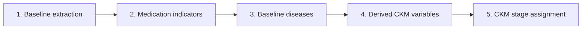

# UK Biobank Baseline CKM Phenotyping and Staging

**This README covers eight scripts: five main processing scripts (1–5), a CKM stage check (6), an HbA1c conversion example check (7), and an eGFR example check (8).**

Python scripts for deriving baseline cardiovascular–kidney–metabolic (CKM) variables and assigning CKM stages 0–4 from a wide-format UK Biobank export.

The main workflow constructs baseline measurements, medication indicators, prevalent disease phenotypes, kidney and metabolic risk variables, and predicted 10-year cardiovascular risk. The final participant-level dataset is `UKB_baseline.csv`, containing the derived variables, `ckm_stage`, and `ckm_stage_status`.

**Run the main workflow sequentially: 1 → 2 → 3 → 4 → 5. Each of these five scripts depends on the preceding steps.** Run script 6 after stage assignment. Scripts 7 and 8 are standalone example checks and can be run independently.

## Scripts and execution order

The filenames below are suggested names for the eight supplied programs. Save your programs under these names, or replace the filenames in the example commands with the names used in your repository.

| Order | Suggested filename | Inputs | Main task | Output |
| --- | --- | --- | --- | --- |
| 1 | `01_extract_baseline.py` | `visit_data.csv` | Extract baseline demographics, anthropometry, blood pressure, and biomarkers; perform unit conversions. | Create `UKB_baseline.csv`. |
| 2 | `02_add_medications.py` | `visit_data.csv` and `UKB_baseline.csv` | Derive antihypertensive, lipid-lowering, and glucose-lowering medication indicators and merge by `eid`. | Update `UKB_baseline.csv`. |
| 3 | `03_define_baseline_diseases.py` | `visit_data.csv` and `UKB_baseline.csv` | Derive baseline CHD, stroke, AF, PAD, HF, hypertension, diabetes, and prediabetes indicators. | Update `UKB_baseline.csv`. |
| 4 | `04_derive_ckm_variables.py` | `UKB_baseline.csv` | Derive adiposity, triglyceride, MetS, eGFR, UACR, KDIGO risk, and PREVENT variables. | Update `UKB_baseline.csv`. |
| 5 | `05_assign_ckm_stages.py` | `UKB_baseline.csv` | Assign CKM stages using descending priority and three-state missing-data logic. | Add or update `ckm_stage` and `ckm_stage_status` in `UKB_baseline.csv`. |
| 6 | `06_check_ckm_stages.py` | `UKB_baseline.csv` with assigned stages and the required covariates | Check stage conditions, exclusion of higher stages, and derived-variable consistency; retain passing participants with all original covariates. | `UKB_baseline for CKM.csv` and diagnostic reports. |
| 7 | `07_check_hba1c_conversion.py` | Eight built-in examples | Verify HbA1c conversion using `0.0915 × mmol/mol + 2.15`, with exact decimal calculation and two-decimal display checks. | `hba1c_examples_check.csv`. |
| 8 | `08_check_egfr_calculation.py` | Three built-in examples | Verify equation selection and calculated values for the 2009 creatinine, 2012 cystatin C, and 2012 combined eGFR equations. | `egfr_examples_check.csv`. |



## Software requirements

- Python 3.8 or later.
- Python standard library only; no additional packages are required.
- Sufficient memory for participant-level medication and diagnosis lookup tables in steps 2 and 3. Runtime and memory use depend on export size and width.

## Input data and configuration

### File format

The main workflow expects **comma-separated CSV files**, including the raw wide-format input `visit_data.csv`. Text is read using UTF-8 with optional BOM support.

A native Tab-delimited `.tab` export requires format conversion or adaptation of the raw-data readers. Renaming a `.tab` file to `.csv` does not change its delimiter or quotation rules.

The raw input must contain one participant per row and a unique, non-empty, digits-only `eid` or `f.eid`. Participant IDs are retained as text and are used for merges; row order is not used for matching.

Required columns must exist even when some participants have missing values. A missing measurement is different from an absent column.

### Paths and working directory

Main-workflow paths are defined near the top of each script:

| Script | Path settings |
| --- | --- |
| 1 | `INPUT_PATH = Path("visit_data.csv")`; `OUTPUT_PATH = Path("UKB_baseline.csv")` |
| 2–3 | `VISITS = Path("visit_data.csv")`; `BASELINE = Path("UKB_baseline.csv")` |
| 4–5 | `BASELINE = Path("UKB_baseline.csv")` |

Relative paths resolve against the **current working directory**. Keep the scripts and local input file in the same working directory, or edit these constants to use explicit paths. No command-line path options are implemented.

### Supported column names

For repeated fields, the raw-data readers normalize these equivalent names:

| Input example | Normalized name |
| --- | --- |
| `30750-0.0` | `30750-0.0` |
| `f.30750.0.0` | `30750-0.0` |
| `p30750_i0_a0` | `30750-0.0` |
| `p30750_i0` | `30750-0.0` |

The format is `FieldID-instance.array`. Ordinary baseline measurements use instance 0 and array 0. Step 1 also recognizes the non-repeated RAP sex field `p31`. Step 3 additionally supports flattened hospital array names such as `p41270_a0`.

The supplied readers do **not** recognize bare dot-separated names such as `30750.0.0`. Normalize such headers before running the workflow or adapt the column-name functions consistently in steps 1–3. RAP arrays must be supplied as individual columns rather than serialized lists within a single cell.

### Main UK Biobank fields

| Domain | Fields |
| --- | --- |
| Baseline assessment date | 53 |
| Sex, age, ethnicity, smoking | 31, 21003, 21000, 20116 |
| BMI and waist circumference | 21001, 48 |
| Automated SBP / DBP | 4080 / 4079 |
| Manual SBP / DBP | 93 / 94 |
| HbA1c | 30750 |
| Triglycerides, HDL, total cholesterol | 30870, 30760, 30690 |
| Serum creatinine and cystatin C | 30700, 30720 |
| Urine albumin and urine creatinine | 30500, 30510 |
| Medication questionnaires / interview / count | 6153, 6177 / 20003 / 137 |
| Cardiovascular and hypertension self-report | 6150 |
| Doctor-diagnosed diabetes / pregnancy-only diabetes | 2443 / 4041 |
| Hospital ICD-10 diagnoses / corresponding dates | 41270 / 41280 |
| Hospital ICD-9 diagnoses / corresponding dates | 41271 / 41281 |

Blood reportability fields are 30756, 30876, 30766, 30696, 30706, and 30726. Urine result flags are 30505 and 30515. Step 1 reports absent flag columns; when a blood reportability flag is available, only code 1 is accepted. Missing flags allow otherwise valid numeric values but do not establish complete assay-quality assessment.

Step 2 requires baseline medication slots `6153-0.0` through `6153-0.3`, `6177-0.0` through `6177-0.2`, and `20003-0.0` through `20003-0.47`. Field 137 is optional.

Step 3 pairs each hospital diagnosis with the date at the same array index and requires matching, contiguous indices. At least one paired ICD version must be present. Export all relevant hospital arrays: matching indices cannot establish whether trailing records were omitted. Four baseline 6150 slots are needed to establish negative questionnaire responses; positive responses can still be identified with incomplete slots.

## Running the workflow

From the configured working directory, execute each command separately and wait for successful completion before starting the next:

```bash
python 01_extract_baseline.py
python 02_add_medications.py
python 03_define_baseline_diseases.py
python 04_derive_ckm_variables.py
python 05_assign_ckm_stages.py
```

Steps 2–5 update the same baseline CSV. Do not run them concurrently. The full scripts print validation messages and completion counts; they do not provide a live participant-level progress bar.

**Rerunning step 1 recreates `UKB_baseline.csv` and removes downstream columns from the previous run. Rerun steps 2–5 afterward.** If an upstream definition changes, rerun the affected main-workflow step and every later main-workflow step. Repeat script 6 after refreshing the stage assignments. Retain the raw export separately for reproducibility.

### Supporting checks

After completing script 5, run the stage check:

```bash
python 06_check_ckm_stages.py
```

Script 6 checks participants with an assigned stage of 0–4 and saves passing participants with their original columns to `UKB_baseline for CKM.csv`. It leaves `UKB_baseline.csv` unchanged, does not assign replacement stages, and does not recalculate eGFR or PREVENT.

The two calculation examples can be run independently without participant data:

```bash
python 07_check_hba1c_conversion.py
python 08_check_egfr_calculation.py
```

Script 7 checks the eight supplied HbA1c examples using `Decimal` and `ROUND_HALF_UP` for two-decimal display. Script 8 checks the three supplied eGFR examples against reference values. Each writes its own example-results CSV without modifying the baseline dataset.

## Phenotype definitions and implementation choices

### Baseline extraction and units

- Baseline date is taken from `53-0.0` and must be a valid `YYYY-MM-DD` date. Step 1 excludes participants with missing or invalid baseline dates.
- Sex is coded as 0 = female and 1 = male. Ethnicity is grouped as White / Non-White; current smoking is derived from field 20116.
- SBP and DBP are processed separately. Each uses the mean of valid automated readings within baseline instance 0; manual readings are used only when no valid automated reading is available. Follow-up visit readings are not averaged into baseline BP.
- Other continuous measurements use baseline instance 0, array 0, with the numeric range and reportability checks specified in step 1.

| Conversion | Implemented equation |
| --- | --- |
| HbA1c, mmol/mol → % | `hba1c_pct = hba1c_mmol_mol * 0.0915 + 2.15` |
| Triglycerides, mmol/L → mg/dL | Multiply by `88.57`. |
| HDL / total cholesterol, mmol/L → mg/dL | Multiply by `38.67`. |
| Serum creatinine, μmol/L → mg/dL | Divide by `88.4`. |
| Urine creatinine, μmol/L → g/L | Divide by `8840`. |

Analysis values are not rounded before threshold comparisons. Under the specified urine policy, flag values `<6.7` and `<88` trigger substitution with 6.7 mg/L albumin and 88 μmol/L creatinine, respectively. Substitution indicators are retained, and these point values are used directly in downstream UACR calculations.

### Medication indicators

Step 2 produces `antihypertensive_medication_use`, `lipid_lowering_medication_use`, and `glucose_lowering_medication_use` from baseline questionnaires and interview medication codes. The supplied drug-code sets are defined in the script.

Positive evidence takes priority. Recorded medication count 0 with an empty interview can support a negative result. Valid questionnaire responses can support negative antihypertensive and lipid-lowering indicators. Not selecting insulin does not exclude oral glucose-lowering drugs, so the glucose-lowering negative rule is more conservative. Unresolved evidence remains `NA`.

### Baseline diseases

Hospital phenotypes include CHD, stroke, AF, PAD, HF, hypertension, and diabetes. Diagnosis and date arrays are paired before determining whether disease was present at baseline.

| Setting | Default behavior |
| --- | --- |
| `INCLUDE_BASELINE_DAY = True` | A diagnosis on or before the baseline date counts as prevalent disease. |
| `INCLUDE_SELF_REPORTED_CVD = True` | CHD or stroke self-report is combined with the five hospital CVD indicators. |

Disease definitions are implemented in `03_define_baseline_diseases.py`.

`*_prebaseline` variables reflect hospital evidence only. `clinical_cvd` combines the five hospital CVD indicators with CHD / stroke self-report. Hypertension and diabetes statuses additionally incorporate the relevant self-report, medication, and baseline measurements. Pregnancy-only diabetes is handled separately in the diabetes self-report component.

A definite baseline-positive record takes priority over missing evidence. Undated relevant diagnoses or invalid ICD records can prevent a negative hospital classification. `*_first_date` records the earliest available diagnosis date and may be later than baseline.

### Metabolic and kidney variables

| Variable | Definition |
| --- | --- |
| `obesity` | BMI ≥25 kg/m²; this study variable represents overweight / excess adiposity. |
| `abdominal_obesity` | Waist ≥88 cm in females or ≥102 cm in males, applied uniformly across ethnic groups. |
| `prediabetes` | HbA1c ≥5.7% and <6.5%, with a negative combined diabetes status. |
| `hypertriglyceridemia` | Triglycerides ≥135 mg/dL. |
| `mets` | At least three of the five study-adapted MetS components below. |
| `uacr_mg_g` | `urine_albumin_mg_l / urine_creatinine_umol_l * 8840`. |
| `albuminuria_ge30` | UACR ≥30 mg/g. |

The five MetS components are elevated waist circumference; HDL <50/40 mg/dL in females/males; triglycerides ≥150 mg/dL; SBP ≥130 or DBP ≥80 mmHg or antihypertensive use; and HbA1c ≥5.7%. This is an HbA1c-adapted research definition. The CKM triglyceride threshold of 135 and the MetS threshold of 150 are intentionally different.

The eGFR equation hierarchy is:

1. Both serum creatinine and cystatin C available: CKD-EPI creatinine–cystatin C, 2012.
2. Creatinine only: CKD-EPI creatinine, 2009.
3. Cystatin C only: CKD-EPI cystatin C, 2012.

eGFR is calculated for adults aged at least 18 years with known sex and at least one valid biomarker. Serum creatinine enters these equations in mg/dL and cystatin C in mg/L. Legacy race multipliers are fixed at 1. The selected equation is recorded in `egfr_equation`; these are the specified 2009/2012 implementations, not the 2021 equations.

KDIGO G categories use boundaries 90, 60, 45, 30, and 15 mL/min/1.73 m². A categories are A1 <30, A2 30–300, and A3 >300 mg/g. `ckd_risk` is coded as 1 = low, 2 = moderate, 3 = high, and 4 = very high. G4/G5 remain very high risk when albumin category is missing; other missing combinations remain unknown. These are baseline G/A risk classifications; a single assessment does not establish chronicity.

Step 4 retains `obesity` and removes the older `overweight_or_obesity` and `obesity_bmi_ge30` aliases if present.

### PREVENT cardiovascular risk

Step 4 calculates the PREVENT 10-year **total-CVD base model** and stores a percentage in `prevent_cvd_10y_pct`. The high-risk flag `prevent_cvd_10y_ge20` uses a threshold of 20%.

The implementation uses the lipid-lowering medication indicator as the statin proxy, passes the selected legacy eGFR directly to PREVENT, and does not exclude participants with prevalent clinical CVD from calculation. These choices are part of the study implementation.

With the default `PREVENT_RANGE_POLICY = "strict"`, inputs outside the specified ranges produce missing risk: age 30–79 years, eGFR 15–150 mL/min/1.73 m², total cholesterol 130–320 mg/dL, HDL 20–100 mg/dL, and SBP 90–200 mmHg. **The eGFR limit of 150 is an input validity boundary, not an eGFR truncation rule.** `prevent_status` records the calculation status or reason for missing risk.

## CKM stage assignment

Stage assignment follows descending priority: **4 → 3 → 2 → 1 → 0**. A lower stage is assigned only when its conditions are satisfied and every higher stage is explicitly ruled out.

| Stage | Implemented criteria |
| --- | --- |
| 0 | BMI <25, normal waist, HbA1c <5.7%, no diabetes or hypertension, TG <135 mg/dL, low kidney risk, PREVENT <20%, and no clinical CVD, with higher stages excluded. |
| 1 | Overweight / excess adiposity, abdominal obesity, or prediabetes; no hypertension, diabetes, or MetS; TG <135; low kidney risk; PREVENT <20%; no clinical CVD. |
| 2 | At least one of high TG, hypertension, diabetes, MetS, or moderate/high kidney risk; no very high kidney risk; PREVENT <20%; no clinical CVD. |
| 3 | No clinical CVD and either very high kidney risk or PREVENT ≥20%. Additional background-risk criteria are not mandatory in this implementation. |
| 4 | Clinical CVD and at least one of the nine background-risk criteria. |

The nine stage-4 background criteria are overweight / excess adiposity, abdominal obesity, prediabetes, high TG, hypertension, diabetes, MetS, moderate/high kidney risk, and very high kidney risk. High PREVENT risk alone is not one of these nine criteria.

Clinical CVD with all nine background criteria explicitly negative is left unclassified rather than automatically assigned stage 4.

## Missing values and final outputs

The final dataset is **`UKB_baseline.csv`**, with one row per participant retained after step 1. Steps 2–5 preserve the cohort and update or append their derived columns.

| Output | Meaning |
| --- | --- |
| `ckm_stage` | Integer 0–4 when classifiable; otherwise `NA`. |
| `ckm_stage_status` | Explanation of the assignment or reason no stage was assigned. |

| `ckm_stage_status` | Meaning |
| --- | --- |
| `classified` | A stage is determined and all higher stages are excluded. |
| `higher_stage_uncertain` | A lower-stage rule is satisfied but at least one higher stage remains uncertain. |
| `insufficient_data` | Missing information prevents a definite stage. |
| `clinical_cvd_without_background_risk` | Clinical CVD is positive but all nine background risks are explicitly negative. |
| `criteria_not_met` | Available information does not satisfy a complete stage definition. |

The scripts write missing derived values as `NA`. Missing is not treated as negative: any definite positive resolves an OR condition, any definite negative resolves an AND condition, and otherwise unresolved conditions remain unknown.

## Reproducibility and data availability

Keep the raw export, the script version, and the study-definition settings used for each analysis. Input checks include required columns, participant IDs, duplicate headers, row widths, and diagnosis/date pairing. Outputs are written through temporary files before replacing the baseline CSV.

Participant-level UK Biobank data must be obtained separately through approved [UK Biobank access](https://www.ukbiobank.ac.uk/). Raw exports and participant-level derived CSV files are not distributed with this code documentation.
